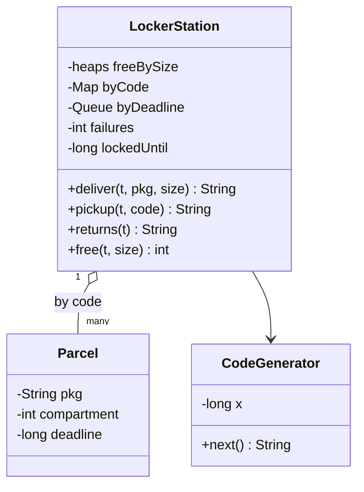

# Parcel Locker

Implement a parcel locker station `LockerStation`: a courier's delivery gets a compartment and a pickup code, the customer collects with the code, and parcels not collected in time go back. It is the system design course's [LLD case: Amazon Locker](/system-design/lld-case-amazon-locker).

Compartments come in three sizes, small (S), medium (M) and large (L), and so do parcels. Compartments are numbered from 1: first the s small ones, then the m medium ones, then the l large ones. The driver passes sizes to you as integers: 0 = S, 1 = M, 2 = L. Time is always the integer t given in the operation, and it never decreases from one operation to the next.

**Pickup codes**: the station keeps an integer x, starting at the seed from the input. For each new code:

x = (x × 1103515245 + 12345) mod 2^31, and the code is x mod 10^6 written with 6 digits (leading zeros), for example `004217`.

If the new code equals the code of a parcel **still in the locker**, take the next one, until it differs. The multiplication overflows 32 bits, so use 64-bit integers. A real system uses a cryptographically secure random source; a fixed formula lets the judge replay it.

**Expiry**: a parcel delivered at time t has a deadline of t + keep, and **counts as expired at the deadline**. At the start of every operation, every parcel still in the locker whose deadline is ≤ the current t moves, in delivery order, to the "to return" list: its compartment is freed and its code stops working. Then the operation itself runs.

| Method | Does and returns |
| --- | --- |
| `deliver(t, pkg, size)` | Assign a compartment the parcel fits in: one of its own size first, otherwise larger sizes in order (medium, then large), taking the lowest-numbered free compartment of a size. If none is free, return `FULL`. Otherwise make a code and return `compartment code` |
| `pickup(t, code)` | The customer types `code` on the keypad (compared as a string: `004217` is not `4217`); see below |
| `returns(t)` | The returns courier takes every parcel on the "to return" list: return their ids in the order they joined it (separated by spaces) and empty it; `NONE` if it is empty |
| `free(t, size)` | Free compartments of **exactly** that size |

**Pickup** `pickup(t, code)`:

1. The keypad is locked (t < the unlock time): return `LOCKED`, without checking the code or counting a failure.
2. `code` is the valid code of a parcel in the locker: the compartment opens and is freed, the code stops working, the consecutive failure count resets, and it returns `pkg compartment`.
3. Otherwise return `INVALID` and add 1 to the consecutive failure count; when it reaches 5, the keypad locks with an unlock time of t + 30 and the count resets.

Complexity: `deliver` and `pickup` in O(log n) for n compartments (code collisions aside); each parcel expires at most once.

### Design notes

- **A replaceable assignment policy.** "The smallest compartment that fits" is one strategy; "keep large compartments free" or "lowest compartments first" are others. One pool of free compartments per size, ordered by number; taking one out claims it.
- **Pickup codes are a security problem.** Codes must be random and unpredictable and avoid codes in use, and the keypad must resist brute force by locking after repeated failures. Six digits make only a million codes; without a lockout, someone at the keypad could simply try them all.
- **Find parcels by code, not by compartment.** The customer knows only the code, so a hash map from code to parcel finds the compartment in O(1).
- **Lazy expiry.** The deadline is the delivery time plus a fixed keep, so a queue in delivery order is already in deadline order. Handling what is due at the start of each operation needs no timer thread; a real system runs a scheduled job that creates the return orders.

## Input

The first line holds five integers s m l keep seed: the numbers of small, medium and large compartments, how long a parcel may stay, and the code seed. The second line is the number of operations q, and each of the next q lines is one operation:

deliver t pkg size / pickup t code / returns t / free t size

size is one of S, M, L. pkg is a parcel id of letters and digits (at most 10 characters, all different); code is 1 to 6 digits.

0 ≤ s, m, l ≤ 2×10^4, s + m + l ≥ 1; 1 ≤ keep ≤ 10^9; 0 ≤ seed < 2^31; 1 ≤ q ≤ 2×10^4; 0 ≤ t ≤ 10^9.

## Output

One line per operation: the return value given in the table and the rules above.

## Explanation

Compartment 1 is small, 2 medium and 3 large; parcels stay 100 and the seed is 42. book goes into 1; lamp is small too, the small compartment is taken, so it goes into the medium compartment 2; desk takes the large compartment 3; mug is medium, and both medium and large are taken: FULL. No small compartment is free now. book's code works once; the second time it no longer exists: INVALID. Compartment 1 is free again.

lamp was delivered at 0 with deadline 100, desk at 5 with deadline 105. At 99 nothing has expired: NONE. At 105 both have, and they go back in delivery order: lamp desk. lamp's code is INVALID after that, and the medium compartment 2 is free.

## Hints

- Write the code generator first and check it against the three codes in the sample before the rest.
- Update the "to return" list and the code map together: an expired parcel leaves the code map, then joins the list.
- A code may be given to a new parcel after the old one was collected, so on expiry make sure the queued parcel is still the one in the map.
