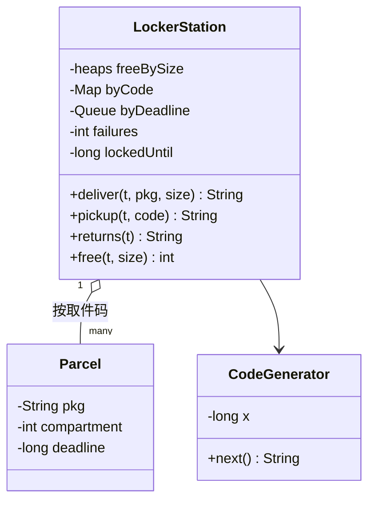

# 快递柜

实现一个快递柜站点 `LockerStation`：快递员投递时分配格口、生成取件码，顾客凭码取件，超期没取的包裹退回。题目对应系统设计课的 [LLD 案例：快递柜](/system-design/lld-case-amazon-locker)。

格口分小（S）、中（M）、大（L）三种尺寸，包裹也分这三种。格口编号从 1 开始：先是 s 个小格口，再是 m 个中格口，最后是 l 个大格口。驱动把尺寸换成整数传给你：0 = S，1 = M，2 = L。时间一律用操作里给的整数时刻 t，按操作顺序不减。

**取件码**：站点持有一个整数 x，初值是输入给的 seed。每次要一个新码时：

x = (x × 1103515245 + 12345) mod 2^31，取件码 = x mod 10^6，补足 6 位（前面补 0），比如 `004217`。

如果新码和某个**还在柜子里的包裹**的取件码相同，就再取下一个，直到不重复。乘法会超过 32 位，请用 64 位整数。真实系统要用密码学安全的随机数，这里用固定的公式，判题才能复现。

**超期**：包裹在 t 时刻投递，截止时刻是 t + keep，**到了截止时刻就算超期**。每个操作开始时，先把所有截止时刻 ≤ 当前 t、还没被取走的包裹按投递顺序移进“待退回”列表，空出它们的格口，取件码作废；然后再执行操作本身。

| 方法 | 作用和返回值 |
| --- | --- |
| `deliver(t, pkg, size)` | 分配能装下包裹的格口：先找同尺寸的，没有空的再按 中、大 的顺序往大了找，同一尺寸里取编号最小的空格口。都满了返回 `FULL`。否则生成取件码，返回 `格口 取件码` |
| `pickup(t, code)` | 顾客在键盘上输入 code（按字符串比较，`004217` 和 `4217` 不同），规则见下 |
| `returns(t)` | 退件员取走所有待退回的包裹：按进入列表的顺序返回包裹编号（以空格分隔）并清空列表；列表为空返回 `NONE` |
| `free(t, size)` | 尺寸**恰好**为 size 的空格口数 |

**取件** `pickup(t, code)`：

1. 键盘被锁（t < 解锁时刻）：返回 `LOCKED`，不检查取件码，也不计入错误次数。
2. code 是某个柜内包裹的有效取件码：格口打开并空出，取件码作废，连续错误次数清零，返回 `包裹编号 格口`。
3. 否则返回 `INVALID`，连续错误次数加 1；加到 5 次时锁住键盘，解锁时刻为 t + 30，连续错误次数清零。

复杂度：`deliver`、`pickup` 为 O(log n)（n 为格口数，取件码重复的情况忽略不计），超期处理每个包裹只处理一次。

### 设计要点

- **分配策略可替换**：“能装下的最小格口”只是一种策略，也可以换成“尽量留大格口”或者“优先离地面近的格口”。每种尺寸一个按编号排序的空格口池，取出即占用。
- **取件码是安全问题**：码要随机、不可预测，要避开还在用的码；键盘要防暴力尝试，连续输错就锁一段时间。6 位数字只有 100 万种，不加锁定的话，一台机器上逐个试就能试出来。
- **按码查包裹，不按格口查**：顾客只知道取件码，所以用“取件码 → 包裹”的哈希表，O(1) 找到格口。
- **超期懒处理**：截止时刻 = 投递时刻 + 固定的 keep，按投递顺序排的队列就是按截止时刻排好的。每次操作开始时处理到期的包裹，不需要定时器线程。真实系统里由定时任务生成退件单。

## 输入

第一行是五个整数 s m l keep seed：小、中、大格口的数量，包裹最长存放时间，取件码种子。第二行是操作数 q，接下来 q 行，每行一个操作：

deliver t pkg size / pickup t code / returns t / free t size

size 是 S、M、L 之一。pkg 是由字母和数字组成的包裹编号（长度不超过 10，互不相同）；code 是 1 到 6 位数字。

0 ≤ s, m, l ≤ 2×10^4，s + m + l ≥ 1；1 ≤ keep ≤ 10^9；0 ≤ seed < 2^31；1 ≤ q ≤ 2×10^4；0 ≤ t ≤ 10^9。

## 输出

每个操作输出一行，内容是上表和上面规则里的返回值。

## 样例说明

1 号是小格口，2 号是中格口，3 号是大格口，存放期 100，种子 42。book 放进 1 号；lamp 也是小件，小格口满了，放进中格口 2；desk 放进大格口 3；mug 是中件，中、大格口都满了，FULL。这时小格口一个也不剩。book 的取件码第一次能取走，第二次就作废了，INVALID；1 号空出来。

lamp 在 0 时刻投递，截止时刻 100；desk 在 5 时刻投递，截止时刻 105。99 时刻还没有超期的包裹，NONE。105 时刻两个都超期了，按投递顺序退回 lamp desk。之后再用 lamp 的码取件是 INVALID，中格口 2 已经空出来。

## 提示

- 先实现取件码生成器，单独核对样例里的三个码，再写其余部分。
- 待退回列表和取件码表要一起更新：包裹超期时，从取件码表里删掉它，再放进待退回列表。
- 同一个取件码可能在旧包裹被取走后重新分配给新包裹，处理超期时要确认队列里的包裹还是表里的那一个。
