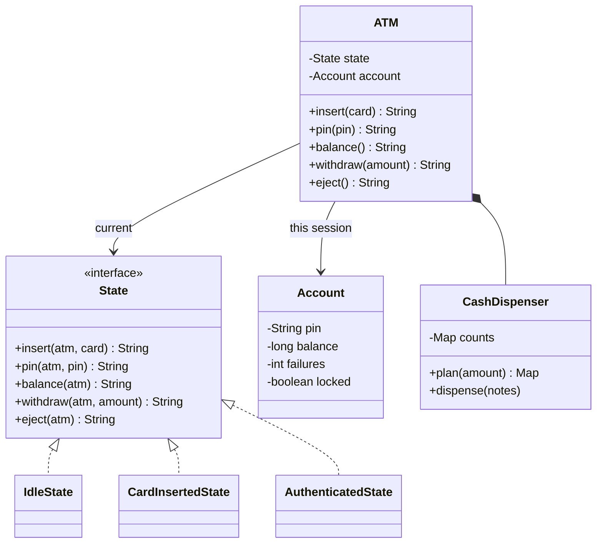

# ATM

Implement an ATM: insert a card, enter the PIN, check the balance, withdraw cash, take the card back. It is the system design course's [LLD case: ATM](/system-design/lld-case-atm). The same button means different things at different stages, which is exactly what the State pattern is for.

The machine has three states: `IDLE` (no card), `CARD_INSERTED` (a card is in, PIN not yet accepted) and `AUTHENTICATED` (PIN accepted). It starts `IDLE`. Any operation the current state does not allow returns `NOT_NOW` and changes nothing.

| Method | Allowed in | Does and returns |
| --- | --- | --- |
| `insert(card)` | IDLE | An unknown card returns `UNKNOWN_CARD`; a locked card returns `CARD_LOCKED`; either way the card comes back out and the state stays. Otherwise `OK`, and the state becomes CARD_INSERTED |
| `pin(pin)` | CARD_INSERTED | See below |
| `balance()` | AUTHENTICATED | The current balance |
| `withdraw(amount)` | AUTHENTICATED | See below |
| `eject()` | CARD_INSERTED, AUTHENTICATED | Return the card, end the session, back to IDLE; returns `OK` |
| `cash()` | any state | How many 10, 50 and 100 notes the machine has left |

**PIN**: PINs compare as strings (`0007` is not `7`). Each card counts its **consecutive** wrong PINs across sessions; a correct PIN resets the count.

- Correct: reset the count, return `OK`, move to AUTHENTICATED.
- Wrong: add 1 to the count. At 3 the card is locked (the machine keeps it), the session ends back in IDLE, and it returns `LOCKED`; a locked card never works again. Below 3 it returns `WRONG_PIN tries left`, for example `WRONG_PIN 2`, and stays in CARD_INSERTED.

**Withdrawal** `withdraw(amount)` checks in order, and the first failure returns its result and changes nothing:

1. amount ≤ 0 or not a multiple of 10: `BAD_AMOUNT`.
2. amount above the per-withdrawal limit of 2000: `OVER_LIMIT`.
3. amount above the balance: `INSUFFICIENT_FUNDS`.
4. Notes: going from 100 to 50 to 10, take as many of each as fit (no more than the machine has left). If that does not add up exactly, `NO_NOTES`.
5. Success: debit the balance, take out the notes, and return `valuexcount` from the largest value down, leaving out values with a count of 0, for example `100x2 50x1 10x3`. The session goes on, and another withdrawal may follow.

Each of 10, 50 and 100 divides every larger value, so even with a limited number of each note, greedy finds a combination whenever one exists, and with the fewest notes.

Complexity: O(1) per operation (the number of note values is fixed), with a hash map from card to account.

### Design notes

- **The State pattern.** One class per state; the state interface gives every action a default "not now", and each state overrides only what it allows. An "out of service" stage is one more class, not one more `if` in every method.
- **A facade.** The card reader and keypad talk only to `ATM`, which hands each request to the current state.
- **Make sure the notes are there, then debit.** The balance drops only after the note plan exists. In a real system the debit happens at the bank: a failed payout must be reversed, and every withdrawal carries a unique transaction id so a retry after a timeout never debits twice.
- **Wrong tries belong to the card (the account), not the session.** Kept on the session, a thief could pull the card out after two wrong tries, put it back and guess forever.

## Input

The first line holds three integers: how many 10, 50 and 100 notes the machine has. The second line is the number of cards n, followed by n lines of `card PIN balance`. Then comes the number of operations q, and each of the next q lines is one operation:

insert card / pin p / balance / withdraw amount / eject / cash

Card ids are letters and digits, at most 16 characters, all different; account PINs are 4 digits; the p typed in an operation is 1 to 8 digits.

0 ≤ notes ≤ 10^4, 1 ≤ n ≤ 1000, 0 ≤ balance ≤ 10^9, 1 ≤ q ≤ 2×10^4, |amount| ≤ 10^4.

## Output

One line per operation: the return value given in the table and the rules above.

## Explanation

A balance check with no card in: NOT_NOW. dave is not a card of this bank: UNKNOWN_CARD. With bob's card in, inserting another is NOT_NOW. The PIN is 0007, so 7 and 0000 are both wrong, leaving 2 and then 1 tries; the balance stays NOT_NOW until the PIN is accepted. After the right PIN, entering a PIN again is NOT_NOW. The balance is 120: 130 is more than that, 75 is not a multiple of 10, and 120 comes out as one 100 and two 10s, leaving 0. A second eject after the first is NOT_NOW.

alice gets one PIN wrong and takes her card back; the count is still there when she returns. Two more wrong PINs make 3: the card is locked and the machine is back in IDLE, so inserting alice's card again is CARD_LOCKED. The machine has eight 10s, four 50s and one 100 left.

## Hints

- Let every method of the state interface return NOT_NOW by default and have each state class write only what it allows; the authenticated state can extend the card-inserted state and reuse eject.
- State changes live in the state classes: when a card is accepted, IdleState switches the ATM to CardInsertedState.
- Do not turn the PIN into an integer before comparing.
