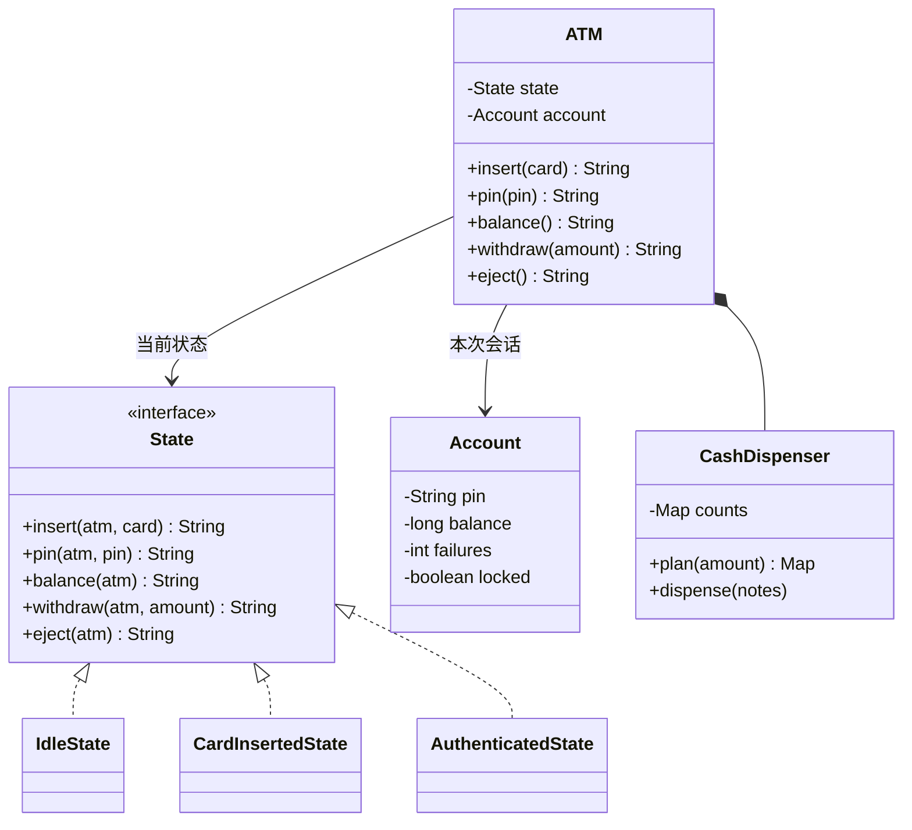

# ATM 取款机

实现一台 ATM：插卡、输 PIN、查余额、取款、退卡。题目对应系统设计课的 [LLD 案例：ATM](/system-design/lld-case-atm)。同一个按钮在不同阶段意义不同，这正是状态模式要解决的问题。

机器有三个状态：`IDLE`（没有卡）、`CARD_INSERTED`（已插卡，还没通过 PIN）、`AUTHENTICATED`（PIN 正确）。一开始是 `IDLE`。当前状态不允许的操作一律返回 `NOT_NOW`，不改变任何东西。

| 方法 | 允许的状态 | 作用和返回值 |
| --- | --- | --- |
| `insert(card)` | IDLE | 卡号不存在返回 `UNKNOWN_CARD`；卡已被锁返回 `CARD_LOCKED`；两种情况卡都退出，状态不变。否则返回 `OK`，进入 CARD_INSERTED |
| `pin(pin)` | CARD_INSERTED | 规则见下 |
| `balance()` | AUTHENTICATED | 返回当前余额 |
| `withdraw(amount)` | AUTHENTICATED | 规则见下 |
| `eject()` | CARD_INSERTED、AUTHENTICATED | 退卡，结束会话，回到 IDLE，返回 `OK` |
| `cash()` | 任何状态 | 返回机器里 10、50、100 面额的钞票各剩几张 |

**PIN**：PIN 按字符串比较（`0007` 和 `7` 不同）。每张卡记录**连续**输错的次数，跨会话累计，输对一次就清零。

- 输对：清零，返回 `OK`，进入 AUTHENTICATED。
- 输错：次数加 1。累计到 3 次时锁卡（机器吞卡），会话结束回到 IDLE，返回 `LOCKED`；锁住的卡以后都不能再用。不到 3 次时返回 `WRONG_PIN 剩余次数`，比如 `WRONG_PIN 2`，仍停在 CARD_INSERTED。

**取款** `withdraw(amount)` 依次检查，第一条不满足就返回对应的结果，什么都不改：

1. amount ≤ 0 或者不是 10 的倍数：`BAD_AMOUNT`。
2. amount 超过单笔上限 2000：`OVER_LIMIT`。
3. amount 超过余额：`INSUFFICIENT_FUNDS`。
4. 配钞：从 100 到 50 再到 10，每种面额取“够用的最多张数”（不超过机器里剩的张数）。凑不齐返回 `NO_NOTES`。
5. 成功：扣余额，扣钞票，返回从大到小的 `面额x张数`，张数为 0 的面额不写，比如 `100x2 50x1 10x3`。会话继续，可以接着取款。

10、50、100 中每种面额都能整除更大的面额，所以即使每种钞票张数有限，只要存在任何一种凑法，贪心也一定能凑出来，而且张数最少。

复杂度：每个操作 O(1)（面额种数是常数），按卡号查账户用哈希表。

### 设计要点

- **状态模式**：每个状态一个类，状态接口给每个操作一个默认实现“现在不行”，每个状态只覆盖自己允许的操作。加一个“暂停服务”状态，只要加一个类，不用在每个方法里再加一个 `if`。
- **门面**：读卡器和键盘只和 `ATM` 打交道，`ATM` 把请求转给当前状态。
- **先确认能出钞，再扣款**：配钞方案算出来之后才扣余额。真实系统里扣款在银行那边，出钞失败就要冲正，而且每笔取款要带唯一的交易号，网络超时重试也不会扣两次。
- **连续输错次数放在卡（账户）上，而不是会话上**：放在会话上的话，输错两次就退卡重插，可以无限次猜 PIN。

## 输入

第一行是三个整数：机器里 10、50、100 面额的钞票张数。第二行是卡的数量 n，接下来 n 行，每行是 `卡号 PIN 余额`。然后是操作数 q，接下来 q 行，每行一个操作：

insert card / pin p / balance / withdraw amount / eject / cash

卡号由字母和数字组成，长度不超过 16，互不相同；账户的 PIN 是 4 位数字；操作里输入的 p 是 1 到 8 位数字。

0 ≤ 钞票张数 ≤ 10^4，1 ≤ n ≤ 1000，0 ≤ 余额 ≤ 10^9，1 ≤ q ≤ 2×10^4，|amount| ≤ 10^4。

## 输出

每个操作输出一行，内容是上表和上面规则里的返回值。

## 样例说明

没有插卡时查余额：NOT_NOW。dave 不是本行的卡：UNKNOWN_CARD。插入 bob 的卡后，再插卡是 NOT_NOW。PIN 是 0007，输 7 和 0000 都不对，剩 2 次、1 次；没通过 PIN 时查余额是 NOT_NOW。输对之后再输 PIN 是 NOT_NOW。余额 120：取 130 余额不足，取 75 不是 10 的倍数，取 120 出一张 100、两张 10，余额变成 0。退卡后再退卡是 NOT_NOW。

alice 插卡输错一次就退卡，再插卡时错误次数还在：再错两次，累计 3 次，卡被锁，回到 IDLE。之后插入 alice 的卡是 CARD_LOCKED。机器里剩 8 张 10、4 张 50、1 张 100。

## 提示

- 让状态接口的每个方法默认返回 NOT_NOW，三个状态类只写自己允许的操作；已认证状态可以继承已插卡状态，复用退卡。
- 状态切换写在状态类里：插卡成功时由 IdleState 把 ATM 的状态换成 CardInsertedState。
- PIN 不要转成整数比较。
