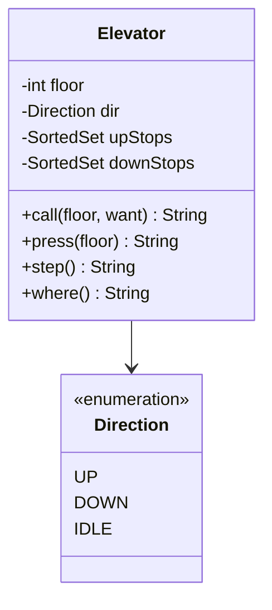

# Elevator Scheduling

Schedule one elevator car, `Elevator`. Time advances in steps: each `step` moves the car at most one floor, or opens its doors once without moving. It is the system design course's [LLD case: elevator](/system-design/lld-elevator), with a single car and no dispatch between cars.

Floors are numbered 1 to F. There are two kinds of request:

- **Hall calls** `call(floor, want)`: someone on `floor` pressed the up (`UP`) or down (`DOWN`) button.
- **Car calls** `press(floor)`: someone inside the car pressed `floor`.

The car keeps two sets of floors to stop at, classified by **the direction the car travels when it stops there**, not by whether the floor is above or below it:

- `upStops`: floors to stop at while going up. Up hall calls go here, and so do car calls above the current floor.
- `downStops`: floors to stop at while going down. Down hall calls go here, and so do car calls below the current floor.

A floor appears at most once in a set. "Work above" means either set holds a floor higher than the current one; "work below" likewise.

Methods to implement:

| Method | Does |
| --- | --- |
| `Elevator(F, start)` | F floors; the car waits at `start`, direction `IDLE`, no requests |
| `call(floor, want)` | Add `floor` to the set for `want`; return `OK` |
| `press(floor)` | Above the current floor: add it to `upStops`; below: to `downStops`; both return `OK`. At the current floor the doors open at once, nothing is recorded, and it returns `OPEN` |
| `step()` | Advance one step, by the rules below |
| `where()` | Return `floor direction pending`, where pending is the sizes of both sets added up; changes nothing |

`step()` does three things in order:

1. **Pick the direction** (only the first rule that applies, once):
   - Direction `UP` with no work above: `DOWN` if there is work below, otherwise `IDLE`.
   - Direction `DOWN` with no work below: `UP` if there is work above, otherwise `IDLE`.
   - Direction `IDLE`: `UP` if there is work above, otherwise `DOWN` if there is work below, otherwise stay `IDLE`. With work on both sides, up goes first.
   - None of these applies (say, `UP` with work still above): the direction stays.
2. **Direction `IDLE`**: there is no work anywhere else, so serve this floor: remove the current floor from both sets and open the doors if anything was removed. The car does not move.
3. **Direction `UP` or `DOWN`**:
   - If the current floor is in this direction's set (`upStops` going up, `downStops` going down), remove it and open the doors without moving.
   - Otherwise move one floor. On arrival, remove the floor from this direction's set and open if it was there. If there is no work left ahead (above when going up, below when going down), this is the far end of the sweep: also remove the floor from the other set, and open if it was there.

`step()` returns `floor direction event`: the floor and direction after the step, and `OPEN` if the doors opened in this step or `-` if not.

Complexity: with ordered sets (`TreeSet`, `std::set`) each operation is O(log F). F is at most 200 here, so scanning the floors to look for work above also passes.

### Design notes

- **Classify requests by the direction of the stop.** The car is at 5 going up and someone on 7 presses down. Sorted by floor alone, the car would stop at 7 and carry a passenger who wants to go down up to the top first. With the down call in `downStops`, the car passes 7 on the way up and picks them up after it turns.
- **LOOK, not first come first served.** Serve everything ahead in the current direction and turn only when nothing is ahead. The car does not zigzag, and no request starves: there are finitely many floors, so every sweep turns within F − 1 floors, and any request is served by the end of the current sweep plus one sweep each way.
- **All state in one class.** Only `Elevator` changes its floor, direction and sets. With several cars, a `Dispatcher` picks which car answers a hall call, kept apart from each car's own scheduling.
- **Steps, not the wall clock.** The scheduling never reads the system time, so a test can replay every step exactly. A real system calls `step` from one thread or event loop on a fixed tick.

## Input

The first line holds the number of floors F and the starting floor. The second line is the number of operations q, and each of the next q lines is one operation:

call floor U / call floor D / press floor / step / where

1 ≤ F ≤ 200, 1 ≤ start, floor ≤ F, 1 ≤ q ≤ 2×10^4.

## Output

One line per operation: `call` prints OK; `press` prints OK or OPEN; `step` prints the floor, the direction and OPEN or -; `where` prints the floor, the direction and the number of pending stops.

## Explanation

The car is idle at floor 5. Pressing 7 adds it to `upStops`; the down calls at 3 and 9 go into `downStops`. The first step finds work above, turns UP and reaches 6 without stopping; the second reaches 7, which is in `upStops`, and opens. Now someone on 8 presses down: the car passes 8 going up, because 9 is still ahead. At 9 nothing is left above, so this is the end of the sweep, the down call at 9 is served too, and the doors open.

Down stops at 8 and 3 remain: where prints 9 UP 2. The next step finds nothing above and work below, turns DOWN and opens at 8. Then someone in the car presses 1 and someone on 4 presses up. Going down the car passes 4 without stopping (that call is for going up) and opens at 3 and at 1. Only the up call at 4 is left, so where prints 1 DOWN 1; the car turns for it on the next step.

## Hints

- Decide whether there is work above or below, then the direction, and only then move; in another order the car overshoots the end of a sweep or turns too early.
- The floor at the end of a sweep may be in both sets: remove it from both, and open the doors once.
- When the direction is IDLE there is no work above or below, so the only requests left can be for the current floor.
