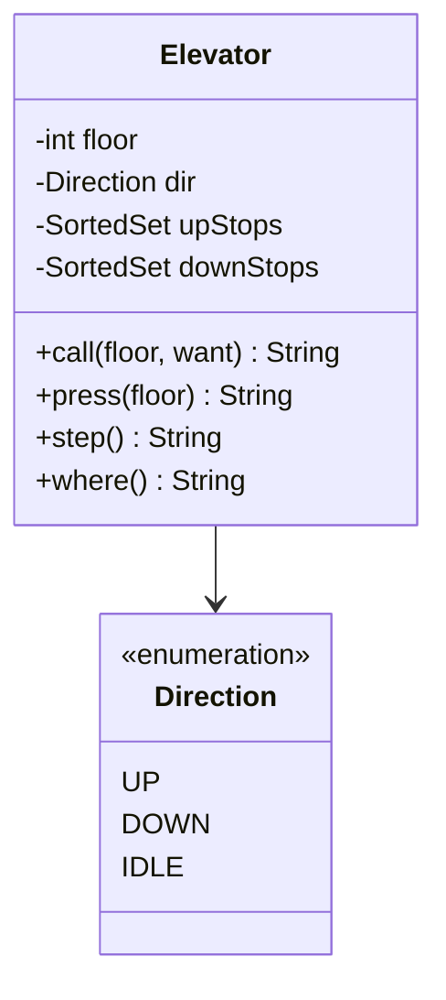

# 电梯调度

实现一部电梯 `Elevator` 的调度。时间按“步”推进：每次 `step` 电梯最多移动一层，或者原地开一次门。题目对应系统设计课的 [LLD 案例：电梯](/system-design/lld-elevator)，这里只做一部电梯，不涉及多部电梯之间的分派。

楼层编号为 1 到 F。请求有两种：

- **厅外呼叫** `call(floor, want)`：有人在 floor 层按了上行（`UP`）或下行（`DOWN`）按钮。
- **轿厢内按钮** `press(floor)`：电梯里的人按了 floor 层。

电梯用两个集合记录要停的楼层，按“在这一层停下时电梯往哪个方向走”分类，而不是按楼层在电梯上方还是下方分类：

- `upStops`：上行时要停的楼层。上行的厅外呼叫放这里；轿厢内按了比当前楼层高的楼层，也放这里。
- `downStops`：下行时要停的楼层。下行的厅外呼叫放这里；轿厢内按了比当前楼层低的楼层，也放这里。

同一楼层在一个集合里只记一次。“上方有任务”指两个集合里有楼层高于当前楼层，“下方有任务”同理。

需要实现的方法：

| 方法 | 作用 |
| --- | --- |
| `Elevator(F, start)` | 共 F 层，电梯停在 start 层，方向为 `IDLE`，没有任何请求 |
| `call(floor, want)` | 把 floor 放进 want 对应的集合，返回 `OK` |
| `press(floor)` | floor 高于当前楼层放进 `upStops`，低于放进 `downStops`，都返回 `OK`；等于当前楼层时直接开门，什么都不记，返回 `OPEN` |
| `step()` | 推进一步，规则见下 |
| `where()` | 返回 `楼层 方向 待停数`，待停数是两个集合的大小之和；不改变状态 |

`step()` 按顺序做三件事：

1. **定方向**（只按下面第一条成立的规则改一次）：
   - 方向是 `UP` 且上方没有任务：下方有任务就改为 `DOWN`，否则改为 `IDLE`。
   - 方向是 `DOWN` 且下方没有任务：上方有任务就改为 `UP`，否则改为 `IDLE`。
   - 方向是 `IDLE`：上方有任务就改为 `UP`；否则下方有任务就改为 `DOWN`；否则保持 `IDLE`。上下都有任务时先上行。
2. **方向为 `IDLE`**：别处都没有任务，就服务本层：把当前楼层从两个集合里都删掉，删掉了至少一个就开门。电梯不移动。
3. **方向为 `UP` 或 `DOWN`**：
   - 如果当前楼层在本方向的集合里（上行看 `upStops`，下行看 `downStops`），删掉它并开门，这一步不移动。
   - 否则移动一层。到达后，从本方向的集合里删掉这一层，删掉了就开门。如果到达后前方（上行看上方，下行看下方）已经没有任务，说明这是本趟的尽头，再从另一个集合里删掉这一层，删掉了也开门。

`step()` 返回 `楼层 方向 事件`：楼层和方向是这一步之后的值，事件为 `OPEN`（这一步开了门）或 `-`。

复杂度：用有序集合（`TreeSet`、`std::set`）时每个操作 O(log F)。本题 F 不超过 200，逐层扫描判断“上方有没有任务”也能通过。

### 设计要点

- **按停靠方向分类请求**：电梯在 5 层上行，7 层有人按了下行。如果只按楼层高低排序，电梯会在 7 层停下，把要下楼的人先带到楼上。把下行呼叫放进 `downStops`，上行途中就不会为它停，等折返下行时再接。
- **LOOK 而不是先来先服务**：先把当前方向上的请求一趟服务完，前方没有任务才掉头。电梯不会来回折返，请求也不会被饿死：楼层有限，每一趟最多走 F − 1 层就会掉头，任何请求最多等电梯走完当前这一趟、再上下各走一趟就会被服务。
- **状态集中在一个类**：楼层、方向、两个集合只由 `Elevator` 自己修改。多部电梯时再加一个 `Dispatcher` 决定由哪部电梯响应厅外呼叫，分派和单部电梯的调度分开写。
- **用步数代替真实时钟**：调度逻辑不读系统时间，测试时就能精确重放每一步。实际系统里由一个线程或事件循环按固定节拍调用 `step`。

## 输入

第一行是楼层数 F 和初始楼层 start。第二行是操作数 q，接下来 q 行，每行一个操作：

call floor U / call floor D / press floor / step / where

1 ≤ F ≤ 200，1 ≤ start, floor ≤ F，1 ≤ q ≤ 2×10^4。

## 输出

每个操作输出一行：`call` 输出 OK；`press` 输出 OK 或 OPEN；`step` 输出 楼层、方向和 OPEN 或 -；`where` 输出 楼层、方向和待停数。

## 样例说明

电梯在 5 层空闲。按 7 层放进 `upStops`，3 层和 9 层的下行呼叫放进 `downStops`。第一步上方有任务，方向变为 UP，到 6 层不停；第二步到 7 层，7 在 `upStops` 里，开门。这时 8 层有人按下行：电梯上行经过 8 层不停，因为上方还有 9 层；到 9 层后上方没有任务了，这是本趟的尽头，9 层的下行呼叫一起服务，开门。

此时还剩下行的 8 层和 3 层，where 输出 9 UP 2。下一步上方没有任务、下方有，掉头下行，到 8 层开门。之后轿厢内按 1 层，4 层有人按上行。电梯下行经过 4 层不停（那是上行的呼叫），在 3 层和 1 层开门。最后只剩 4 层的上行呼叫，where 输出 1 DOWN 1，下一步才会掉头去接它。

## 提示

- 先判断“上方或下方还有没有任务”，再决定方向，最后才移动；顺序弄错，电梯会在尽头多走一层或者提前掉头。
- 本趟尽头的楼层可能同时在两个集合里，两个都要删掉，但只算开一次门。
- 方向为 IDLE 时上下都没有任务，只可能还剩当前楼层的请求。
