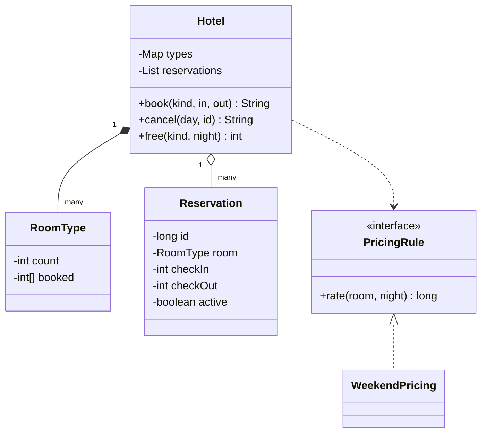

# Hotel Booking

Implement booking for one hotel, `Hotel`: book a room for a range of dates, cancel, and check the free rooms for a night. It is the system design course's [LLD case: hotel booking](/system-design/lld-case-hotel-booking). The key is that a room is not simply free or taken: it is free or taken **night by night**.

Days are integers: day 0 is a Monday, day 4 a Friday, day 5 a Saturday, and so on. A booking with check-in day `in` and check-out day `out` takes the **nights** in to out − 1; the check-out night does not count, so a stay from 3 to 6 covers nights 3, 4 and 5.

Each room type has a number of rooms `count`, a weekday rate `base` and a weekend rate `weekend`. Friday and Saturday nights (night mod 7 is 4 or 5) cost the weekend rate, every other night the weekday rate.

| Method | Does and returns |
| --- | --- |
| `book(kind, in, out)` | Book one room of type `kind` from `in` to `out`. If out − in is not between 1 and 30, return `INVALID`. If any night from in to out − 1 is fully booked for that type (rooms taken = count), return `FULL` and take nothing. Otherwise take one room on every night; reservations are numbered from 1 in the order of successful bookings; return `id total`, where the total is the sum of the nightly rates |
| `cancel(day, id)` | Cancel reservation `id` on day `day`. An id that does not exist or is already cancelled returns `INVALID`; day ≥ the check-in day (the stay has started) returns `TOO_LATE` and cancels nothing; otherwise cancel, give one room back on every night, and return `OK` |
| `free(kind, night)` | How many rooms of type `kind` are left on night `night` |

Complexity: `book` and `cancel` in O(nights), `free` in O(1).

### Design notes

- **Count inventory per (room type, night).** No reservation gets a room number; the hotel only counts how many rooms of each type are taken each night. Never overbooking means exactly that: on every night the rooms taken never exceed the rooms there are. The front desk assigns the actual room at check-in.
- **Check every night, then take them together.** If one night in the middle is full the whole booking fails, leaving nothing half booked. In a database this is one conditional update, or a transaction that locks those rows.
- **The check-out day is not a night.** One guest's check-out day may be the next guest's check-in day with no conflict on the same room. Half-open ranges are the least error-prone.
- **Pricing rules are strategies.** Weekend rates, seasonal rates and long-stay discounts are different `PricingRule` implementations that can stack, with no change to the booking flow.
- **Cancelling depends on time.** A stay that has started cannot be cancelled. Real hotels add rules like "cancelling within 24 hours of check-in costs one night", another replaceable policy.

## Input

The first line is the number of room types T, followed by T lines of `name rooms weekday-rate weekend-rate`. Then comes the number of operations q, and each of the next q lines is one operation:

book kind in out / cancel day id / free kind night

Room type names are lowercase letters, at most 10 characters, all different; every kind in an operation is one of them.

1 ≤ T ≤ 10, 1 ≤ rooms ≤ 10^4, 1 ≤ rate ≤ 10^6, 1 ≤ q ≤ 2×10^4, 0 ≤ in, out ≤ 10^5, 0 ≤ day ≤ 10^5, 0 ≤ id ≤ 10^9, 0 ≤ night < 10^5.

## Output

One line per operation: the return value given in the table.

## Explanation

Two standard rooms at 100 on weekdays and 150 at weekends; one suite at 300 and 420. Reservation 1 stays 3 to 6, a Thursday, Friday and Saturday night: 100 + 150 + 150 = 400. Reservation 2 takes night 4 (a Friday): 150. Booking 4 to 8 then finds both rooms taken on night 4: FULL, and nights 5 to 7 stay untouched, so night 4 has 0 free rooms and night 7 has 2. A suite from 10 to 10 is not even one night: INVALID.

Cancelling reservation 2 on day 2 works, and 4 to 8 now fits: 150 + 150 + 100 + 100 = 500, reservation 3. Cancelling reservation 1 on day 3 is TOO_LATE: it checks in that day. On the same day, cancelling reservation 3, which starts on day 4, works, and a second cancel is INVALID. Only reservation 1 holds a room on night 4, leaving 1 free. The suite from 0 to 7 is a whole week: 5 weekday nights + 2 weekend nights = 2340, and no suite is free on night 6.

## Hints

- Keep an array per room type of how many rooms are taken each night; `free` is a subtraction.
- Book in two passes: the first only checks, the second adds one; a cancel subtracts one on the same nights.
- A reservation must remember its room type, check-in and check-out, so a cancel knows which nights to give back.
