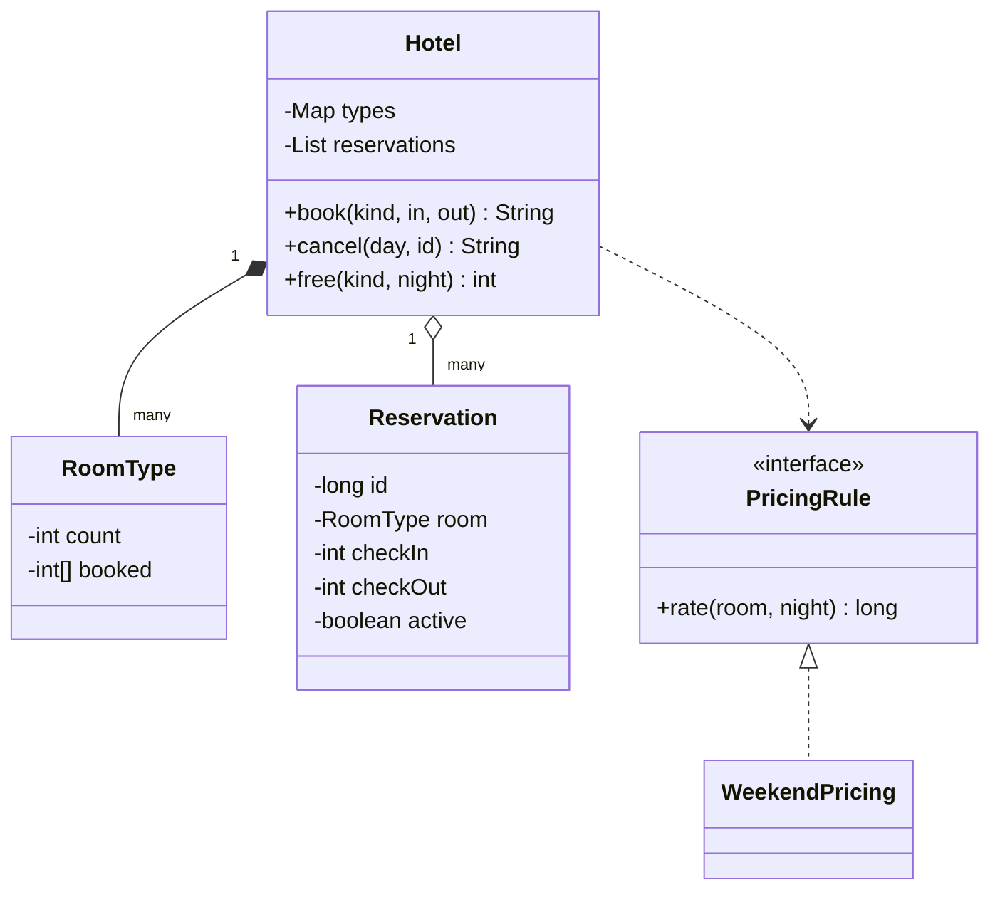

# 酒店预订

实现一家酒店的预订 `Hotel`：按日期区间订房、取消、查某一晚的空房。题目对应系统设计课的 [LLD 案例：酒店预订](/system-design/lld-case-hotel-booking)。关键在于房间不是简单的“空”或“满”，而是**按晚**算空或满。

日期用整数表示，第 0 天是周一，第 4 天是周五，第 5 天是周六，以此类推。入住日 in、退房日 out 的预订占用 in 到 out − 1 这些**晚上**，退房那天晚上不算：住 3 到 6 就是第 3、4、5 晚。

每种房型有房间数 count、平日价 base、周末价 weekend。周五晚和周六晚（night mod 7 为 4 或 5）按周末价，其余按平日价。

| 方法 | 作用和返回值 |
| --- | --- |
| `book(kind, in, out)` | 订一间 kind 房型，从 in 住到 out。out − in 不在 1 到 30 之间返回 `INVALID`。in 到 out − 1 中只要有一晚这种房型已经订满（已订间数 = count），返回 `FULL`，什么都不占。否则每晚各占一间，预订编号从 1 开始按成功的顺序递增，返回 `编号 总价`，总价是每晚房价之和 |
| `cancel(day, id)` | 在第 day 天取消预订 id。编号不存在或者已经取消过，返回 `INVALID`；day ≥ 入住日（已经开始住了），返回 `TOO_LATE`，不取消；否则取消，所有晚上各还回一间，返回 `OK` |
| `free(kind, night)` | 第 night 晚 kind 房型还剩几间 |

复杂度：`book` 和 `cancel` 为 O(晚数)，`free` 为 O(1)。

### 设计要点

- **库存按（房型, 晚）计数**：不给每个预订指定具体房号，只数每种房型每晚订出了几间。不超卖的条件就是“每一晚的已订数都不超过房间数”。具体房号在前台办入住时再分配。
- **先检查所有晚，再一起占用**：中间某一晚满了就整体失败，不会留下订了一半的状态。数据库里通常写成一条带条件的更新，或者在一个事务里锁住这些行。
- **退房日不算一晚**：前一位客人的退房日可以是下一位的入住日，同一间房不冲突。区间用左闭右开最不容易出错。
- **价格规则是策略**：周末价、旺季价、连住折扣都是 `PricingRule` 的不同实现，可以叠加；预订流程不用改。
- **取消要看时间**：入住之后不能再取消。真实系统还会有“入住前 24 小时内取消收一晚房费”这类规则，同样是一个可以替换的策略。

## 输入

第一行是房型数 T，接下来 T 行，每行是 `名称 房间数 平日价 周末价`。然后是操作数 q，接下来 q 行，每行一个操作：

book kind in out / cancel day id / free kind night

房型名称由小写字母组成，长度不超过 10，互不相同；操作里的 kind 一定是已有的房型。

1 ≤ T ≤ 10，1 ≤ 房间数 ≤ 10^4，1 ≤ 价格 ≤ 10^6，1 ≤ q ≤ 2×10^4，0 ≤ in, out ≤ 10^5，0 ≤ day ≤ 10^5，0 ≤ id ≤ 10^9，0 ≤ night < 10^5。

## 输出

每个操作输出一行，内容是上表里的返回值。

## 样例说明

标准间 2 间，平日 100、周末 150；套房 1 间，平日 300、周末 420。预订 1 住 3 到 6，是周四、周五、周六三晚：100 + 150 + 150 = 400。预订 2 住第 4 晚（周五），150。再订 4 到 8 时第 4 晚两间都订出去了，FULL，第 5 到 7 晚也没有被占用：第 4 晚空房 0 间，第 7 晚空房 2 间。订套房 10 到 10 不足一晚，INVALID。

第 2 天取消预订 2 成功，再订 4 到 8 就有房了：150 + 150 + 100 + 100 = 500，编号 3。第 3 天取消预订 1：它当天入住，TOO_LATE。同一天取消第 4 天才入住的预订 3 成功，再取消一次是 INVALID。第 4 晚只剩预订 1 占着一间，空房 1 间。套房住 0 到 7 是整整一周：5 晚平日 + 2 晚周末 = 2340，第 6 晚套房就没有空的了。

## 提示

- 每种房型一个数组，记录每晚订出了几间；`free` 直接相减。
- 订房分两遍：第一遍只检查，第二遍才加一；取消时对同样的晚上减一。
- 预订要记住房型、入住日和退房日，取消时才知道还回哪些晚上。
