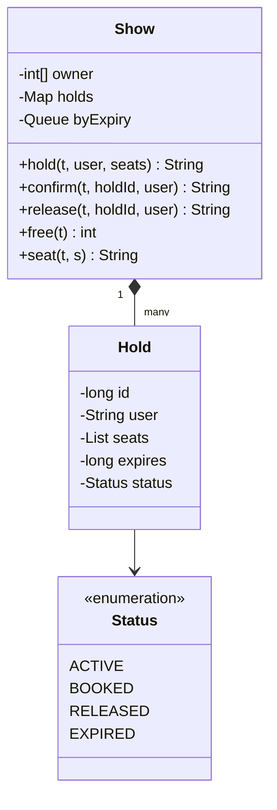

# Movie Seat Booking

Implement seat selection for one show, `Show`: a user holds seats, pays within the hold period to confirm, and seats left unconfirmed are released when the hold runs out. It is the system design course's [LLD case: movie tickets](/system-design/lld-case-movie-tickets); the point is holding several seats all or nothing, and releasing expired holds.

Seats are numbered 1 to n, and every hold lasts ttl. Time is always the integer t given in the operation, never the wall clock; t never decreases from one operation to the next.

A **hold** is in one of four states: `ACTIVE` (holding), `BOOKED` (confirmed, the seats are sold), `RELEASED` (given up by the user) and `EXPIRED` (timed out). A hold made at time t expires at t + ttl, and **counts as expired at that moment** (it is valid during [t, t + ttl)).

**At the start of every operation**, every `ACTIVE` hold whose expiry time is ≤ the current t becomes `EXPIRED` and its seats are freed; then the operation itself runs. A seat is free exactly when no `ACTIVE` or `BOOKED` hold has it.

| Method | Does and returns |
| --- | --- |
| `hold(t, user, seats)` | `user` holds every seat in `seats` (all different within one hold). More than 10 seats returns `TOO_MANY`; checking in the order listed, if the first seat that is not free is s, return `UNAVAILABLE s` and hold nothing. On success create a hold, numbered from 1 in the order of successful holds, and return its number |
| `confirm(t, holdId, user)` | Payment confirmed: the hold becomes `BOOKED`, its seats sold; returns `OK` |
| `release(t, holdId, user)` | Given up: the hold becomes `RELEASED`, its seats free again; returns `OK` |
| `free(t)` | The number of free seats |
| `seat(t, s)` | `FREE` if seat s is free, `HELD user` if held, `BOOKED user` if sold |

`confirm` and `release` check in order: a hold number that does not exist or belongs to another user returns `INVALID`; an expired hold returns `EXPIRED`; a hold already confirmed or released returns `INVALID`. None of these changes anything.

Complexity: `hold` in O(k) for k seats; `confirm`, `release`, `free` and `seat` in amortized O(1), each hold expiring once.

### Design notes

- **A seat's state belongs to the show.** The same physical seat may be sold for the 7 pm show and free for the 9 pm one, so the state lives on the show (the array in `Show`), not on the seat.
- **All or nothing.** Check that every seat is free first, then take them all at once. A real system uses one transaction, or locks seats in seat-number order, so two users never each hold half and wait on each other.
- **Lazy expiry.** No timer thread is needed: handling the holds that are due at the start of each operation gives the same result as releasing them on the dot. With one ttl for every hold and t never decreasing, a queue in creation order is already in expiry order; with different ttls, use a min-heap.
- **Holds have numbers and owners.** Confirming and releasing both take the number and the user, and someone else's hold, an expired hold or a second confirm is refused, so nobody can release seats another user paid for.

## Input

The first line holds the number of seats n and the hold period ttl. The second line is the number of operations q, and each of the next q lines is one operation:

hold t user k s1 … sk / confirm t holdId user / release t holdId user / free t / seat t s

User names are lowercase letters and digits, at most 10 characters.

1 ≤ n ≤ 10^5, 1 ≤ ttl ≤ 10^9, 1 ≤ q ≤ 2×10^4, 0 ≤ t ≤ 10^9, 1 ≤ k ≤ 20, 1 ≤ si, s ≤ n, 0 ≤ holdId ≤ 10^9. t + ttl may not fit in a 32-bit integer.

## Output

One line per operation: the return value given in the table.

## Explanation

Six seats, holds last 10. At time 0 amy holds seats 1 and 2 and gets hold 1 (valid until just before 10). bo tries seats 2 and 3, but 2 is held: UNAVAILABLE 2, and seat 3 is not held either. bo then holds seat 3 alone and gets hold 2. Three seats are free. bo tries to confirm amy's hold 1: INVALID. amy confirms at time 5 and seats 1 and 2 are sold. bo gives up hold 2 at time 8, freeing seat 3.

At time 9 cy holds seat 3 and gets hold 3, expiring at 19. cy confirms only at 20, after the hold expired at 19: EXPIRED, and seat 3 is free again, making four free seats (3, 4, 5 and 6). Releasing the expired hold is EXPIRED as well.

## Hints

- Keep an array of which hold each seat belongs to (0 for free), and store holds by number.
- Put holds in a queue in creation order; at the start of each operation pop the holds expiring at or before t, and free the seats only of those still ACTIVE.
- Do not take seats while checking for UNAVAILABLE, or a failure needs a rollback.
