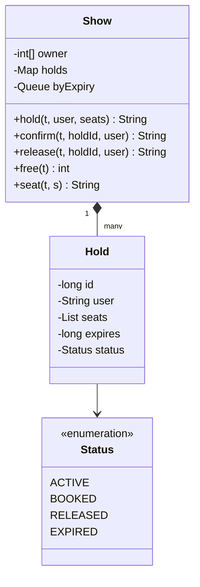

# 电影选座

实现一场电影的选座 `Show`：用户先锁座，在锁定期内付款确认；超时没确认，座位自动释放。题目对应系统设计课的 [LLD 案例：电影选座](/system-design/lld-case-movie-tickets)，重点是“全有或全无”地锁多个座位，以及过期释放。

座位编号 1 到 n，所有锁座的有效期都是 ttl。时间一律用操作里给的整数时刻 t，不读真实时钟；t 按操作顺序不减。

**锁座**有四种状态：`ACTIVE`（锁定中）、`BOOKED`（已确认，座位售出）、`RELEASED`（用户主动放弃）、`EXPIRED`（超时）。锁座在 t 时刻创建，过期时刻是 t + ttl；**到了过期时刻就算过期**（锁座在 [t, t + ttl) 内有效）。

**每个操作开始时**，先把所有过期时刻 ≤ 当前 t、仍处于 `ACTIVE` 的锁座改为 `EXPIRED`，释放它们的座位，然后再执行操作本身。一个座位是空的，当且仅当它不属于任何 `ACTIVE` 或 `BOOKED` 的锁座。

| 方法 | 作用和返回值 |
| --- | --- |
| `hold(t, user, seats)` | user 锁定 seats 里的全部座位（同一次锁座里座位互不相同）。超过 10 个座位返回 `TOO_MANY`；按列出顺序检查，第一个不空的座位是 s 时返回 `UNAVAILABLE s`，一个座位都不锁。成功时新建锁座，编号从 1 开始按成功的顺序递增，返回编号 |
| `confirm(t, holdId, user)` | 确认付款：锁座变为 `BOOKED`，座位售出，返回 `OK` |
| `release(t, holdId, user)` | 主动放弃：锁座变为 `RELEASED`，座位空出，返回 `OK` |
| `free(t)` | 返回当前空座数 |
| `seat(t, s)` | 座位 s 空着返回 `FREE`，被锁定返回 `HELD 用户`，已售出返回 `BOOKED 用户` |

`confirm` 和 `release` 依次检查：锁座编号不存在，或者不是这个用户的，返回 `INVALID`；锁座已经过期，返回 `EXPIRED`；锁座已经确认或放弃过，返回 `INVALID`。这三种情况都不改变任何状态。

复杂度：`hold` 为 O(k)（k 为座位数），`confirm`、`release`、`free`、`seat` 均摊 O(1)，过期处理每个锁座只处理一次。

### 设计要点

- **座位的状态属于“这一场”**：同一个物理座位，19 点那场卖掉了，21 点那场还空着。所以状态挂在场次上（`Show` 里的数组），而不是挂在座位上。
- **全有或全无**：先检查所有座位都空，再一次性锁上。真实系统里用一个事务，或者按座位编号顺序加锁，避免两个人各锁一半互相等待。
- **过期是懒处理的**：不需要定时器线程，每次操作开始时把到期的锁座处理掉，结果和“到点立刻释放”一样。因为所有锁座的 ttl 相同、t 不减，按创建顺序排的队列就是按过期时间排好的；ttl 各不相同时换成小根堆。
- **锁座有编号、有主人**：确认和放弃都要带编号和用户，别人的锁座、过期的锁座、重复的确认都要拒绝，防止付了款的座位被别人放掉。

## 输入

第一行是座位数 n 和锁座有效期 ttl。第二行是操作数 q，接下来 q 行，每行一个操作：

hold t user k s1 … sk / confirm t holdId user / release t holdId user / free t / seat t s

用户名由小写字母和数字组成，长度不超过 10。

1 ≤ n ≤ 10^5，1 ≤ ttl ≤ 10^9，1 ≤ q ≤ 2×10^4，0 ≤ t ≤ 10^9，1 ≤ k ≤ 20，1 ≤ si, s ≤ n，0 ≤ holdId ≤ 10^9。

## 输出

每个操作输出一行，内容是上表里的返回值。

## 样例说明

6 个座位，锁座有效期 10。amy 在 0 时刻锁 1、2 号，得到锁座 1（有效到 10 之前）。bo 想锁 2、3 号，2 号已被锁，UNAVAILABLE 2，3 号也没锁上；bo 改锁 3 号，得到锁座 2。此时空座 3 个。bo 想确认 amy 的锁座 1：INVALID。amy 在 5 时刻确认，1、2 号售出。bo 在 8 时刻放弃锁座 2，3 号空出。

cy 在 9 时刻锁 3 号，得到锁座 3，过期时刻是 19。cy 到 20 才确认，锁座在 19 已经过期，EXPIRED，3 号又空着；空座有 4 个（3、4、5、6）。过期的锁座再放弃也是 EXPIRED。

## 提示

- 用一个数组记录每个座位当前属于哪个锁座（0 表示空），锁座按编号存起来。
- 把锁座按创建顺序放进队列；每个操作开始时从队头弹出过期时刻 ≤ t 的锁座，只有仍是 ACTIVE 的才释放座位。
- 检查 UNAVAILABLE 时不要边检查边锁，否则失败时要回滚。
