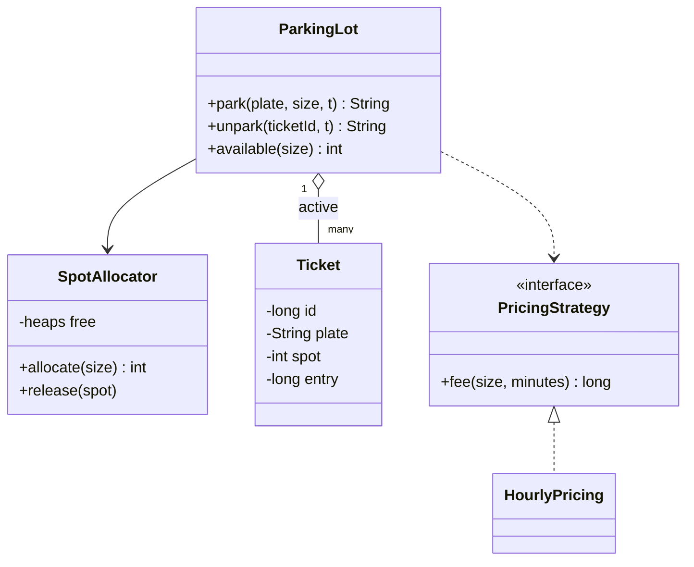

# Parking Lot

Implement a parking lot `ParkingLot` that issues tickets on entry, charges by the hour on exit and reports free spots. It is the system design course's [LLD case: parking lot](/system-design/lld-parking-lot), written as code that runs and is judged.

Spots come in three sizes, small (S), medium (M) and large (L), and so do vehicles. Spots are numbered from 1: first the s small spots, then the m medium ones, then the l large ones. The driver passes sizes to you as integers: 0 = S, 1 = M, 2 = L.

Methods to implement:

| Method | Does |
| --- | --- |
| `ParkingLot(counts, rates)` | `counts[size]` spots of each size; `rates[size]` is that spot size's price per hour |
| `park(plate, size, t)` | A vehicle with plate `plate` and size `size` enters at time t |
| `unpark(ticketId, t)` | The holder of ticket `ticketId` leaves at time t; returns the fee |
| `available(size)` | Free spots of **exactly** that size |

The exact rules:

- **Allocation**: a small vehicle may use a medium or large spot and a medium one a large spot, never the reverse. Try spots of the vehicle's own size first; if none is free, try larger sizes in order (medium, then large). Within a size take the free spot with the **lowest number**.
- **Tickets**: every successful entry issues a new ticket; ticket numbers start at 1 and follow the order of entries. Return `ticket spot`, for example `3 12`.
- **Failed entries**: if a vehicle with the same plate is already inside, return `DUPLICATE` (no spot taken, no ticket issued); if every spot that fits is taken, return `FULL`. Check `DUPLICATE` first.
- **Fees**: the duration is exit time minus entry time in minutes, rounded **up** to whole hours, with at least 1 hour. The fee is hours × the hourly rate of **the spot's size** (a small car in a large spot pays the large rate). The spot is free again as soon as the vehicle leaves, and the plate may enter again.
- **Invalid tickets**: a ticket number never issued, or a ticket that has already been used to leave, returns `INVALID` and changes nothing.

Complexity: `park` and `unpark` in O(log n) for n spots, `available` in O(1). Scanning the spots one by one for a free one is too slow.

### Design notes

- **A facade.** Callers only talk to `ParkingLot`. Allocation, pricing and tickets each live in their own class, so changing a rule means swapping one of them.
- **Sizes are an enum, not subclasses.** Small, medium and large vehicles differ only in data, not in behaviour; a subclass per vehicle type earns nothing.
- **The allocator.** One pool of free spots per size, ordered by number (a min-heap or an ordered set); taking a spot out of the pool claims it. Switching to "nearest the entrance" or "balance the levels" replaces only the allocator.
- **A pricing strategy.** `PricingStrategy` is an interface and hourly pricing is one implementation; monthly passes or night rates are more implementations, with no change to `ParkingLot`. Money is always an integer, never a float.
- **Exits are idempotent.** When the same ticket arrives twice (a retry, two exit gates scanning it at once), the spot must go back to the pool once. So "take the ticket" and "release the spot" belong together: remove the ticket from the active table first, and release the spot only if that removal succeeded.

## Input

The first line holds three integers s m l: the numbers of small, medium and large spots. The second line holds three integers: the hourly price of a small, medium and large spot. The third line is the number of operations q, and each of the next q lines is one operation:

park plate size t / unpark ticket t / available size

size is one of S, M, L; plate is a plate made of letters and digits, at most 10 characters. The time t is in minutes and never decreases from one operation to the next; several operations may share a time.

0 ≤ s, m, l ≤ 2×10^4, s + m + l ≥ 1; 1 ≤ price ≤ 10^4; 1 ≤ q ≤ 10^4; 0 ≤ t ≤ 10^9; 0 ≤ ticket ≤ 10^9. A fee may not fit in a 32-bit integer.

## Output

One line per operation: `park` prints `ticket spot`, `FULL` or `DUPLICATE`; `unpark` prints the fee or `INVALID`; `available` prints the number of free spots.

## Explanation

Spots 1 and 2 are small, 3 is medium and 4 is large, at 2, 3 and 5 an hour. A1 parks in spot 1; B2 takes the medium spot 3; C3 is medium too, the medium spots are full, so it moves up to the large spot 4; D4 is large and the large spot is taken: FULL. A1 is already inside: DUPLICATE. Spot 2 is still free, so available S is 1.

B2 leaves at minute 70 after 60 minutes: 1 hour × 3 = 3. D4 comes back, but the free spot is medium and a large vehicle does not fit: still FULL. C3 leaves at minute 190 after 180 minutes: 3 hours × the large rate 5 = 15, and D4 then takes spot 4. Ticket 2 was already used: INVALID. A1 stayed 200 minutes, rounded up to 4 hours: 4 × 2 = 8. The medium spot 3 is free at the end, so available M is 1.

## Hints

- Keep three pools of free spots, one per size, each giving the lowest number; on exit put the spot back in the pool of its own size, not the vehicle's.
- Two hash maps: ticket number → ticket, and plate → inside or not. An exit updates both.
- Rounding up is (minutes + 59) / 60, then at least 1; use 64-bit integers in C++ and Java.
