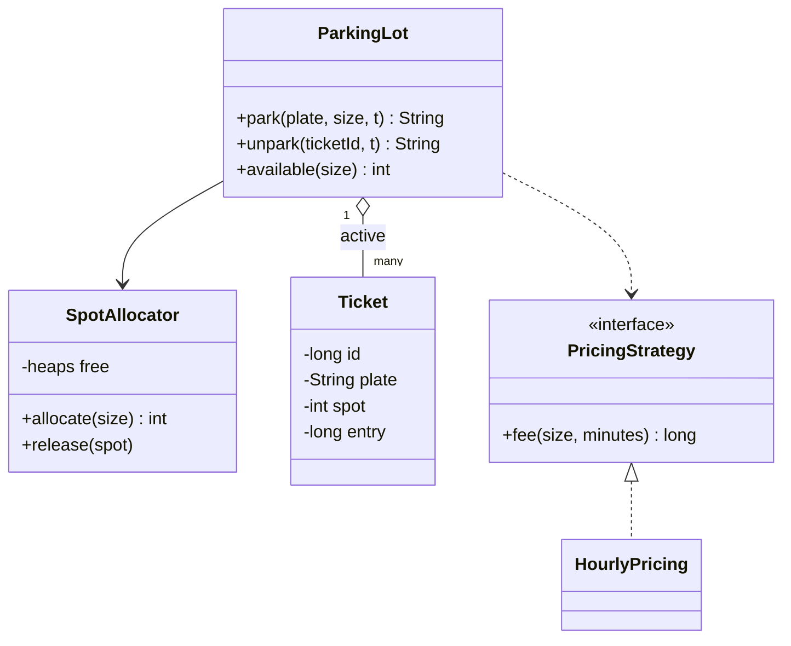

# 停车场

实现一个停车场 `ParkingLot`：入场发停车票、出场按小时计费，并能查询空位。题目对应系统设计课的 [LLD 案例：停车场](/system-design/lld-parking-lot)，这里把它写成能运行、能判对错的代码。

车位分小（S）、中（M）、大（L）三种尺寸，车辆也分这三种。车位编号从 1 开始：先是 s 个小车位，再是 m 个中车位，最后是 l 个大车位。驱动把尺寸换成整数传给你：0 = S，1 = M，2 = L。

需要实现的方法：

| 方法 | 作用 |
| --- | --- |
| `ParkingLot(counts, rates)` | `counts[size]` 是该尺寸的车位数，`rates[size]` 是该尺寸车位每小时的价格 |
| `park(plate, size, t)` | 车牌为 plate、尺寸为 size 的车在 t 时刻入场 |
| `unpark(ticketId, t)` | 凭停车票 ticketId 在 t 时刻出场，返回停车费 |
| `available(size)` | 尺寸**恰好**为 size 的空车位数 |

每个方法的精确规则：

- **分配车位**：小车可以停中、大车位，中车可以停大车位，反过来不行。先找和车一样大的车位；没有空的，再按 中、大 的顺序往大了找。同一尺寸里取**编号最小**的空车位。
- **停车票**：每次入场成功发一张新票，票号从 1 开始按入场顺序递增。返回 `票号 车位号`，比如 `3 12`。
- **入场失败**：这辆车（同一车牌）已经在场内，返回 `DUPLICATE`，不占车位也不发票；能停的车位都满了，返回 `FULL`。先判断 `DUPLICATE`。
- **出场计费**：时长 = 出场时刻 − 入场时刻（分钟），按小时**向上取整**，不足 1 小时按 1 小时算。费用 = 小时数 × **所停车位尺寸**的单价（小车停在大车位，按大车位收费）。出场后车位立刻空出，车牌也可以再次入场。
- **非法停车票**：票号从没发过，或者这张票已经出过场，返回 `INVALID`，不改变任何状态。

复杂度要求：`park`、`unpark` 为 O(log n)（n 为车位总数），`available` 为 O(1)。逐个扫描车位找空位的写法会超时。

### 设计要点

- **门面**：外部只和 `ParkingLot` 打交道。分配车位、计费、管理停车票各由一个类负责，换规则时只换其中一个。
- **尺寸用枚举，不用子类**：小车、中车、大车的区别只在数据上，没有不同的行为，不值得为每种车写一个子类。
- **分配器**：每种尺寸一个按编号排序的空位池（小根堆或有序集合），取出即占用。以后要换成“离入口最近”或“按楼层均衡”，只需换分配器的实现。
- **计费策略**：`PricingStrategy` 是接口，按小时计费只是一种实现；包月、夜间优惠可以再加实现，`ParkingLot` 的代码不用改。金额一律用整数，不用浮点数。
- **出场要幂等**：同一张票被重复提交时（网络重试、两个出口同时扫描），只能有一次真正放回车位。所以“取出票”和“释放车位”要绑定在一起：先从在场票表里删掉这张票，删成功了才释放车位。

## 输入

第一行是三个整数 s m l：小、中、大车位的数量。第二行是三个整数：小、中、大车位每小时的价格。第三行是操作数 q，接下来 q 行，每行一个操作：

park plate size t / unpark ticket t / available size

其中 size 是 S、M、L 之一，plate 是由大写字母、小写字母和数字组成的车牌（长度不超过 10）。时刻 t 以分钟为单位，按操作顺序不减，同一时刻可以有多个操作。

0 ≤ s, m, l ≤ 2×10^4，s + m + l ≥ 1；1 ≤ 单价 ≤ 10^4；1 ≤ q ≤ 10^4；0 ≤ t ≤ 10^9；0 ≤ ticket ≤ 10^9。停车费可能超过 32 位整数的范围。

## 输出

每个操作输出一行：`park` 输出 `票号 车位号`、`FULL` 或 `DUPLICATE`；`unpark` 输出停车费或 `INVALID`；`available` 输出空车位数。

## 样例说明

车位 1、2 是小车位，3 是中车位，4 是大车位，每小时单价依次是 2、3、5。A1 停进 1 号；B2 停进中车位 3；C3 也是中车，中车位已满，往上找到大车位 4；D4 是大车，大车位已满，FULL；A1 已经在场内，DUPLICATE；小车位还剩 2 号，所以 available S 是 1。

B2 在 70 分钟出场，停了 60 分钟，按 1 小时 × 3 收 3。D4 再来，空出来的是中车位，大车停不下，仍然 FULL。C3 在 190 分钟出场，停了 180 分钟，3 小时 × 大车位单价 5 = 15，D4 随后停进大车位 4。票 2 已经用过，INVALID。A1 停了 200 分钟，向上取整为 4 小时，4 × 2 = 8。最后中车位 3 是空的，available M 是 1。

## 提示

- 按尺寸维护三个空位池，每个池按车位号取最小值；出场时把车位放回它自己尺寸的池子，而不是车的尺寸。
- 用两个哈希表：票号 → 停车票，车牌 → 是否在场。出场时两个都要更新。
- 向上取整可以写成 (minutes + 59) / 60，再和 1 取最大值；C++、Java 记得用 64 位整数。
