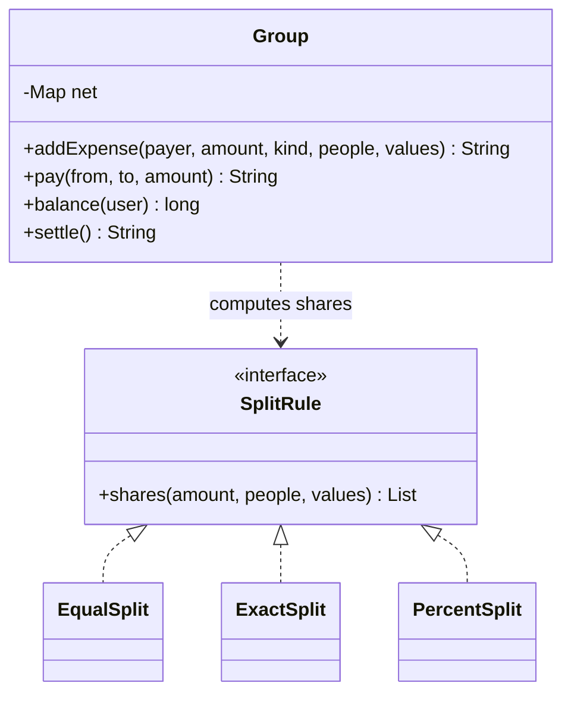

# Splitwise

Implement a shared-expenses ledger `Group`: record who paid and how it is split, report each person's net balance, and produce a settlement plan. It is the system design course's [LLD case: Splitwise](/system-design/lld-case-splitwise), and the point is that **not a cent goes missing or appears from nowhere**.

Every amount is an integer number of cents.

**Net balance**: one integer per person; above 0 means others owe them, below 0 means they owe others, and someone never seen has 0. All net balances always add up to 0.

| Method | Does and returns |
| --- | --- |
| `addExpense(payer, amount, kind, people, values)` | `payer` paid `amount`, split among `people` by `kind` (the payer may be one of them). The payer's balance goes up by `amount` and each participant's goes down by their share. Returns the shares in the order of `people`, separated by spaces; an invalid split returns `INVALID` and records nothing |
| `pay(from, to, amount)` | `from` pays `to` back: `from` goes up by `amount`, `to` goes down by it. Returns `OK` |
| `balance(user)` | The user's net balance |
| `settle()` | The settlement plan (a plan only: no balance changes), by the rule below |

The three kinds of split (k participants):

- **EQUAL** (`values` empty): everyone gets amount / k (rounded down), and the remaining amount mod k cents go one each to the participants in the order of `people`, from the first.
- **EXACT**: `values` are each person's amounts and must add up to `amount`, otherwise `INVALID`.
- **PERCENT**: `values` are each person's share in **basis points** (3333 means 33.33%) and must add up to 10000, otherwise `INVALID`. Everyone first gets amount × basis points / 10000 (rounded down); the leftover cents go one each to the participants with the largest amount × basis points mod 10000, ties in the order of `people`.

**Settlement** `settle()` repeats on the current balances:

1. The person who owes the most (lowest balance) pays the person owed the most (highest balance); among equal amounts, pick the name that comes first in dictionary order.
2. The payer pays the payee min(what one owes, what the other is owed); both outstanding amounts drop by that, and whoever is settled leaves.

until nobody owes anything. Return `count payer1 payee1 amount1 payer2 payee2 amount2 …`, or `0` when there is nothing to settle.

This greedy settles at least one person per transfer, so n people need at most n − 1 transfers, but it is **not always the fewest transfers**: the true minimum means splitting people into as many zero-sum groups as possible, which is NP-hard. Settle by the rule above, which gives one answer.

Complexity: `addExpense` in O(k log k), `settle` in O(n log n) for n people seen.

### Design notes

- **The Strategy pattern.** The three splits take different inputs but all produce "cents owed per person". The ledger stores the computed shares only and never cares how they were made; splitting by shares is one more implementation.
- **Net balances only.** Settlement needs only the net balances; who originally owed whom does not matter. A real system keeps every expense and repayment and derives balances from that log, caching them but never treating the cache as the source of truth.
- **Leftover cents in a fixed order.** Recomputing the same expense must give the same result, so the extra cents go out in a fixed order: no randomness, no floating point.
- **64-bit money.** One expense can be 10^9 cents, net balances pass 32 bits, and amount × basis points reaches 10^13.

## Input

The first line is the number of operations q. Each of the next q lines is one operation:

- expense payer amount EQUAL k p1 p2 … pk
- expense payer amount EXACT k p1 a1 p2 a2 … pk ak
- expense payer amount PERCENT k p1 b1 p2 b2 … pk bk
- pay from to amount
- balance user
- settle

Names are lowercase letters and digits, at most 10 characters; the participants of one expense are all different. 1 ≤ q ≤ 2×10^4, 1 ≤ amount ≤ 10^9, 1 ≤ k ≤ 10, 0 ≤ ai ≤ 10^9, 0 ≤ bi ≤ 10^4. At most 1000 people appear, and settle runs at most 100 times.

## Output

One line per operation: `expense` prints the shares or INVALID, `pay` prints OK, `balance` prints the net balance, `settle` prints the plan.

## Explanation

ann pays 10000 split three ways: 10000 / 3 is 3333 with 1 left, which goes to the first person, ann: shares 3334 3333 3333. bob pays 3000, ann's part 1000 and cat's 2000. cat pays 1001 split 33.33%, 33.33%, 33.34%: 333 each first, 2 cents left over; the remainders are 6333, 6333 and 7334, so cat gets one extra cent first, and ann and bob tie, so the order of the list gives it to ann. ann's EXACT split of 500 adds up to 600: INVALID.

Balances: ann 5332, bob −666, cat −4666, and dan, never seen, 0. Settling, cat owes the most and pays ann 4666; then bob pays ann 666. After cat pays ann 3000, cat is at −1666, and settling again gives cat → ann 1666 and bob → ann 666.

## Hints

- Keep the balances in one hash map from name to a 64-bit integer.
- Settle with two heaps (owing, owed), ordered "larger amount first, then smaller name"; put a partly settled person back into their heap.
- Sort the PERCENT remainders stably, or put the list position into the comparison.
