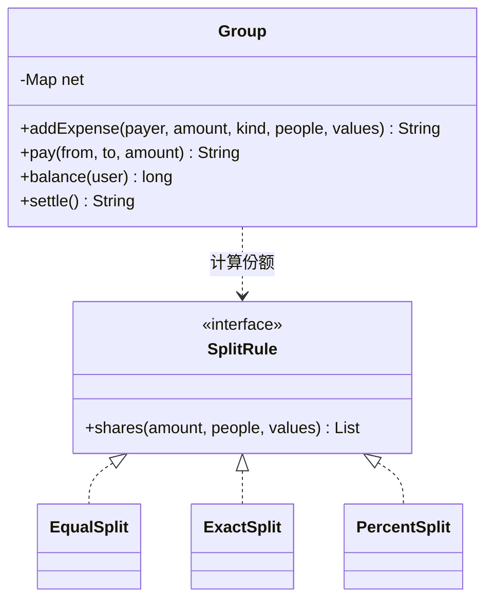

# 分账（Splitwise）

实现一个多人分账的账本 `Group`：记录谁付了钱、怎么分，查询每个人的净额，最后给出一份结算方案。题目对应系统设计课的 [LLD 案例：Splitwise](/system-design/lld-case-splitwise)，重点是**一分钱都不能多也不能少**。

所有金额都是以“分”为单位的整数。

**净额**：每个人一个整数，大于 0 表示别人欠他钱，小于 0 表示他欠别人钱，从没出现过的人净额为 0。所有人的净额加起来永远是 0。

| 方法 | 作用和返回值 |
| --- | --- |
| `addExpense(payer, amount, kind, people, values)` | payer 付了 amount，由 people 中的人按 kind 分摊（payer 自己也可以在 people 里）。payer 净额加 amount，每个参与者净额减去自己的份额。按 people 的顺序返回各人份额，以空格分隔；分摊不合法时返回 `INVALID`，不记账 |
| `pay(from, to, amount)` | from 还给 to 一笔钱：from 净额加 amount，to 净额减 amount。返回 `OK` |
| `balance(user)` | 返回 user 的净额 |
| `settle()` | 返回结算方案（只是给出方案，不改变任何净额），规则见下 |

三种分摊方式（k 是参与人数）：

- **EQUAL**（values 为空）：每人 amount / k（向下取整），余下的 amount mod k 分，按 people 的顺序从第一个人开始每人多分 1 分。
- **EXACT**：values 是每人的金额，加起来必须等于 amount，否则 `INVALID`。
- **PERCENT**：values 是每人的**万分比**（3333 表示 33.33%），加起来必须等于 10000，否则 `INVALID`。每人先分 amount × 万分比 / 10000（向下取整）；余下的分，按 amount × 万分比 mod 10000 从大到小，每人多分 1 分，余数相同的按 people 的顺序。

**结算** `settle()`：在当前净额上反复执行：

1. 选欠得最多的人（净额最小）做付款人，被欠得最多的人（净额最大）做收款人；金额相同时选名字字典序最小的。
2. 付款人付给收款人 min(欠款, 被欠款)，两人的“待结算金额”各减去这笔钱，结清的人退出。

直到没有人欠钱。返回 `笔数 付款人1 收款人1 金额1 付款人2 收款人2 金额2 …`，没有需要结算的就返回 `0`。

这个贪心每一笔至少结清一个人，n 个人最多 n − 1 笔，但**不一定是笔数最少的方案**：求真正的最少笔数要把人分成尽量多个净额和为 0 的小组，是 NP 难问题。本题按上面的规则结算，答案唯一。

复杂度：`addExpense` 为 O(k log k)，`settle` 为 O(n log n)，n 为出现过的人数。

### 设计要点

- **策略模式**：三种分摊方式输入不同，但输出都是“每人欠多少分”。账本只存算好的份额，不关心是怎么分出来的；加一种“按份数分”只要加一个实现。
- **只存净额**：结算只看净额，谁原来欠谁不重要。真实系统要保留每一笔支出和还款，净额从流水算出来，可以缓存但不是唯一的数据来源。
- **余数分配要确定**：同一笔账重算必须得到同样的结果，所以多出来的分按固定顺序分，不能随机，也不能用浮点数。
- **金额用 64 位整数**：单笔可达 10^9 分，净额会超过 32 位；amount × 万分比 可达 10^13。

## 输入

第一行是操作数 q。接下来 q 行，每行一个操作：

- expense payer amount EQUAL k p1 p2 … pk
- expense payer amount EXACT k p1 a1 p2 a2 … pk ak
- expense payer amount PERCENT k p1 b1 p2 b2 … pk bk
- pay from to amount
- balance user
- settle

名字由小写字母和数字组成，长度不超过 10；同一笔支出里参与者互不相同。1 ≤ q ≤ 2×10^4，1 ≤ amount ≤ 10^9，1 ≤ k ≤ 10，0 ≤ ai ≤ 10^9，0 ≤ bi ≤ 10^4。出现的人数不超过 1000，settle 不超过 100 次。

## 输出

每个操作输出一行：`expense` 输出各人份额或 INVALID，`pay` 输出 OK，`balance` 输出净额，`settle` 输出结算方案。

## 样例说明

ann 付 10000，三人平分：10000 / 3 = 3333 余 1，第一个人 ann 多 1 分，份额 3334 3333 3333。bob 付 3000，ann 承担 1000、cat 承担 2000。cat 付 1001 按 33.33%、33.33%、33.34% 分：先各得 333、333、333，余 2 分；三人的余数依次是 6333、6333、7334，cat 先多 1 分，ann 和 bob 余数相同，按顺序给 ann。ann 付 500 的 EXACT 份额加起来是 600，INVALID。

净额：ann 5332，bob −666，cat −4666，dan 没出现过是 0。结算时欠得最多的是 cat，付给 ann 4666；然后 bob 付给 ann 666。cat 还给 ann 3000 后，cat 净额是 −1666，再结算是 cat 付 ann 1666、bob 付 ann 666。

## 提示

- 净额用一个哈希表存，名字到 64 位整数。
- 结算用两个堆（欠款、被欠款），堆顶比较“金额大的优先，金额相同名字小的优先”；部分结清的人放回堆里。
- PERCENT 的余数排序要稳定，或者把“列出顺序”也放进比较里。
