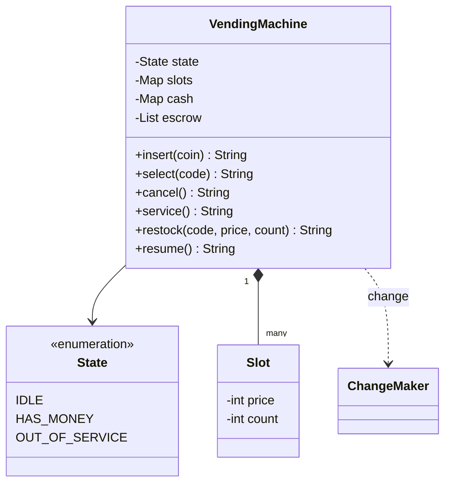

# Vending Machine

Implement a vending machine `VendingMachine`: customers insert coins, pick a product or cancel, and staff restock it. It is the system design course's [LLD case: vending machine](/system-design/lld-case-vending-machine); the point is the state machine, and where the money sits and when it counts.

The machine takes four coin values: 10, 50, 100 and 500. Money lives in two places:

- **Escrow**: the coins the current customer has inserted and not yet spent, in the order inserted.
- **The cash box**: the machine's own coins, used for change.

The machine has three states: `IDLE`, `HAS_MONEY` (a customer's escrow is in) and `OUT_OF_SERVICE` (staff at work). It starts `IDLE` with no slots. Any operation the current state does not allow returns `NOT_NOW` and changes nothing.

| Method | Allowed in | Does and returns |
| --- | --- | --- |
| `insert(coin)` | IDLE, HAS_MONEY | An unknown value returns `REJECTED` (the coin drops back, the state stays); otherwise the coin joins the escrow, the state becomes HAS_MONEY, and it returns the escrow total |
| `select(code)` | HAS_MONEY | Buy from slot `code`, by the rules below |
| `cancel()` | HAS_MONEY | Hand back the escrow's coins as inserted, in that order (separated by spaces); back to IDLE |
| `service()` | IDLE | Enter service mode: the state becomes OUT_OF_SERVICE; returns `OK` |
| `restock(code, price, count)` | OUT_OF_SERVICE | Create the slot if it is new; set its price to `price` and add `count` to its stock; returns `OK` |
| `resume()` | OUT_OF_SERVICE | Leave service mode, back to IDLE; returns `OK` |
| `cashBox()` | any state | How many 10, 50, 100 and 500 coins the cash box holds, escrow excluded |

`select(code)` checks in order, and the first failure returns its result with the escrow and the state unchanged:

1. The slot does not exist or its stock is 0: `SOLD_OUT`.
2. The escrow total is below the price: `INSUFFICIENT shortfall`.
3. Change: the change is escrow total − price. It may use the cash box's coins **and the coins the customer just inserted**. Going from the largest value to the smallest, take as many of each as fit (no more than there are). If that does not add up exactly, return `NO_CHANGE`.
4. The sale: the escrow moves into the cash box, the change leaves it, the stock drops by 1 and the state returns to IDLE. Return the slot code followed by the change coins from largest to smallest, for example `A1 100 50 10`; with no change, just `A1`.

Why greedy change is right here: each of 10, 50, 100 and 500 divides every larger value. In such a coin system, even with a limited number of each coin, greedy finds change whenever any combination exists, and with the fewest coins. (Coins of 50 and 20 alone break this: for 60, greedy takes a 50 first and cannot make the remaining 10, while three 20s would do.)

Complexity: each operation in O(coins in escrow + number of coin values).

### Design notes

- **Escrow apart from the cash box.** A cancel returns the escrow as it is: no change to compute, and no way to fail because the box is short.
- **Work on a copy, then commit once.** Before a sale, compute the change on a copy of "cash box + escrow". Only when the change works do the cash box, escrow, stock and state all update together. A failure at any step needs no rollback: the escrow is still there and the customer can still cancel.
- **The state machine in one place.** Every operation first asks whether the state allows it. With three states and one-line checks an enum is enough; when the states multiply and their behaviour grows, move to a class per state (the State pattern), as in the [ATM chapter](/system-design/lld-case-atm).
- **Money as integers.** Every amount is an integer, so there is no floating-point error.

## Input

The first line holds four integers: how many 10, 50, 100 and 500 coins the cash box starts with. The second line is the number of operations q, and each of the next q lines is one operation:

insert coin / select code / cancel / service / restock code price count / resume / cash

cash is `cashBox()`. code is a slot code of letters and digits, at most 4 characters.

0 ≤ starting coins ≤ 10^4, 1 ≤ q ≤ 2×10^4, 1 ≤ coin ≤ 1000, price is a multiple of 10 with 10 ≤ price ≤ 5000, 0 ≤ count ≤ 100. The escrow never holds more than 50 coins.

## Output

One line per operation: the return value given in the table and the rules above.

## Explanation

The cash box starts with five 10s, two 50s and one 100. Staff enter service mode, set up A1 (120) and B2 (50) and resume. A customer inserts 100 for A1: 20 short. The 5 is unknown and drops back. Another 50 makes 150, so the change is 30: no 500, 100 or 50 fits (30 is less than 50), so three 10s. The box now holds 10×2, 50×3, 100×2. The machine is idle again, so select returns NOT_NOW.

A customer inserts 500 for B2, needing 450 back: two 100s, three 50s and two 10s still leave 80, so NO_CHANGE. The escrow is still there and cancel returns the 500; a second cancel is NOT_NOW. Inserting 100 buys B2 with 50 change. B2 is now empty, so the next try is SOLD_OUT, and cancel returns the 100. Staff enter service mode at the end; the box holds 10×2, 50×2, 100×3.

## Hints

- Before a sale, add the escrow's coins to a temporary copy of the cash box and make change from the copy; on success the copy replaces the box.
- A failed select must not empty the escrow or change the state.
- The change loop has only four values: take min(coins of this value, remaining / value) of each.
