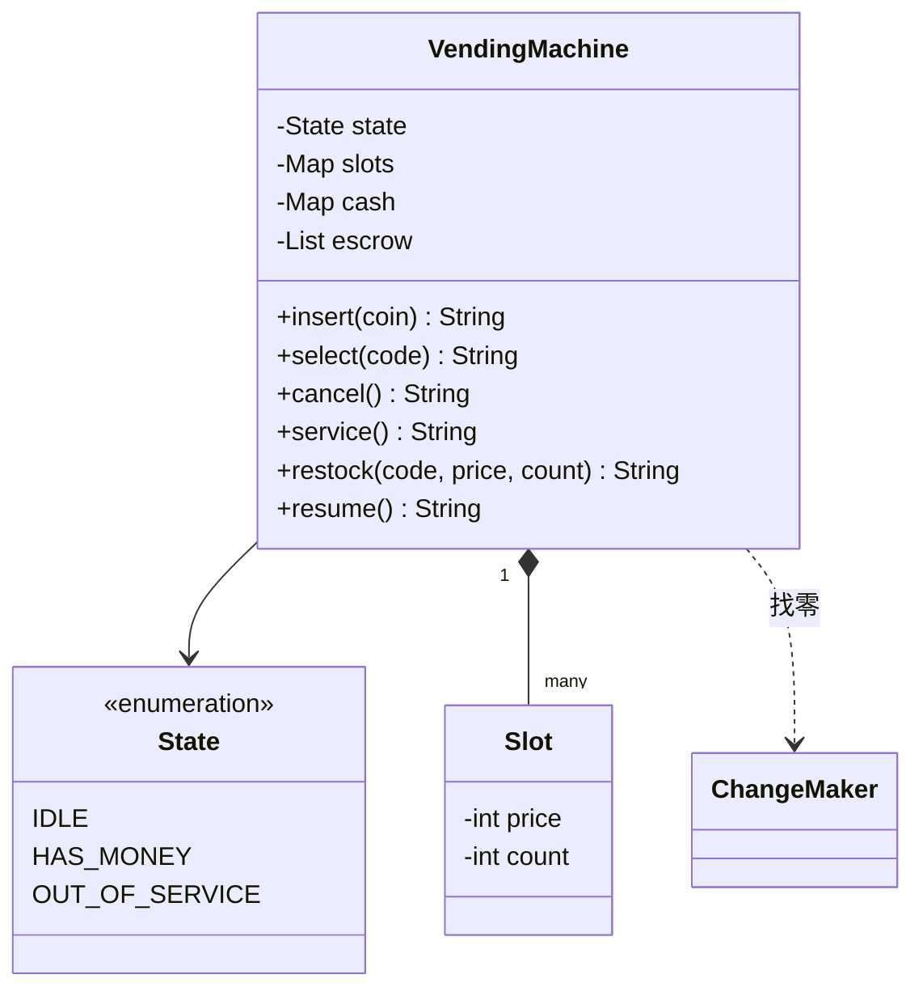

# 自动售货机

实现一台自动售货机 `VendingMachine`：顾客投币、选货、取消，工作人员补货。题目对应系统设计课的 [LLD 案例：自动售货机](/system-design/lld-case-vending-machine)，重点是状态机，以及“钱放在哪、什么时候算数”。

机器只收 10、50、100、500 四种面值的硬币。钱分两处放：

- **押金**：当前顾客投进来、还没花掉的硬币，按投入顺序记下。
- **钱箱**：机器自己的硬币，用来找零。

机器有三个状态：`IDLE`（空闲）、`HAS_MONEY`（有顾客的押金）、`OUT_OF_SERVICE`（工作人员维护中）。一开始是 `IDLE`，没有任何货道。当前状态不允许的操作一律返回 `NOT_NOW`，不改变任何东西。

| 方法 | 允许的状态 | 作用和返回值 |
| --- | --- | --- |
| `insert(coin)` | IDLE、HAS_MONEY | 不认识的面值返回 `REJECTED`（硬币直接退出，状态不变）；否则放进押金，状态变为 HAS_MONEY，返回押金总额 |
| `select(code)` | HAS_MONEY | 买 code 货道的商品，规则见下 |
| `cancel()` | HAS_MONEY | 按投入顺序原样退回押金里的硬币（以空格分隔），状态回到 IDLE |
| `service()` | IDLE | 进入维护，状态变为 OUT_OF_SERVICE，返回 `OK` |
| `restock(code, price, count)` | OUT_OF_SERVICE | 货道不存在就新建；把价格设为 price，库存加 count，返回 `OK` |
| `resume()` | OUT_OF_SERVICE | 结束维护，回到 IDLE，返回 `OK` |
| `cashBox()` | 任何状态 | 返回钱箱里 10、50、100、500 各有几枚，不含押金 |

`select(code)` 依次检查，第一条不满足就返回对应的结果，押金和状态都不变：

1. 货道不存在或者库存为 0：`SOLD_OUT`。
2. 押金总额小于价格：`INSUFFICIENT 差额`。
3. 找零：找零额 = 押金总额 − 价格。找零可以用钱箱里的硬币，**也可以用顾客刚投进来的硬币**。从大面值到小面值，每种面值取“够用的最多枚数”（不超过现有数量）。最后凑不齐就返回 `NO_CHANGE`。
4. 成交：押金并入钱箱，找出去的硬币从钱箱里扣掉，库存减 1，状态回到 IDLE。返回货道编号，后面跟着找零的硬币，从大到小，比如 `A1 100 50 10`；不用找零时只返回 `A1`。

为什么贪心找零在这里一定对：10、50、100、500 中每种面值都能整除比它大的面值。在这种面值体系下，即使每种硬币数量有限，只要存在任何一种凑法，贪心也一定能凑出来，而且用的硬币最少。（面值只有 50 和 20 时就不行：凑 60，贪心先拿一枚 50，剩下的 10 凑不出来，其实三枚 20 就够。）

复杂度：每个操作 O(押金硬币数 + 面值种数)。

### 设计要点

- **押金和钱箱分开**：取消时原样退回押金，不用算找零，也不可能因为钱箱缺钱而退不出来。
- **先在副本上算，再一次提交**：成交前在“钱箱 + 押金”的副本上算好找零；能找零才同时更新钱箱、押金、库存和状态。任何一步失败都不需要回滚，押金还在，顾客仍然可以取消。
- **状态机放在一处**：每个操作先看状态允不允许。三个状态、每个检查一行，用枚举就够了；状态多了、每个状态的行为复杂了，再改成一个状态一个类（状态模式），参考 [ATM 那一章](/system-design/lld-case-atm)。
- **钱用整数**：所有金额都是整数，没有浮点误差。

## 输入

第一行是四个整数：钱箱里初始有几枚 10、50、100、500。第二行是操作数 q，接下来 q 行，每行一个操作：

insert coin / select code / cancel / service / restock code price count / resume / cash

cash 对应 `cashBox()`。code 是由字母和数字组成的货道编号（长度不超过 4）。

0 ≤ 初始硬币数 ≤ 10^4，1 ≤ q ≤ 2×10^4，1 ≤ coin ≤ 1000，price 是 10 的倍数且 10 ≤ price ≤ 5000，0 ≤ count ≤ 100。顾客每次最多投 50 枚硬币。

## 输出

每个操作输出一行，内容是上表和上面规则里的返回值。

## 样例说明

钱箱初始有 5 枚 10、2 枚 50、1 枚 100。工作人员进入维护，放好 A1（120）和 B2（50），结束维护。顾客投 100 买 A1，差 20。5 不认识，退出。再投 50，押金 150，找零 30：没有 500、100、50 可用（30 不够一枚 50），拿 3 枚 10。钱箱变成 10×2、50×3、100×2。机器回到空闲，这时 select 返回 NOT_NOW。

顾客投 500 买 B2，要找 450：拿 2 枚 100、3 枚 50、2 枚 10，还差 80，NO_CHANGE。押金还在，取消原样退回 500；再取消一次就是 NOT_NOW。投 100 买 B2，找 50。B2 卖完了，再买就是 SOLD_OUT，取消退回 100。最后进入维护，钱箱是 10×2、50×2、100×3。

## 提示

- 成交前先把押金里的硬币加进一个临时的钱箱副本，在副本上找零；成功了再用副本替换钱箱。
- 失败的 select 不要清空押金，也不要改变状态。
- 找零的循环只有四种面值：每种取 min(现有枚数, 剩余金额 / 面值)。
